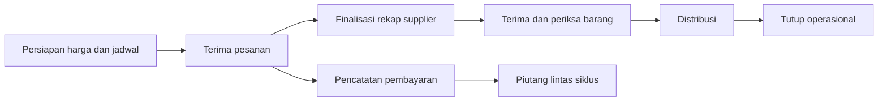

# Review HATO dan rancangan perbaikan

Tanggal: 28 September 2026. Status: rancangan untuk dibahas, belum diimplementasikan.

Metode UX: DEGRADED, single-context. Pemanggilan subagen gagal dengan `Unknown model ag/gemini-3.8-flash-medium`. Penilaian manual A diselesaikan sebelum membaca hasil detector B; keduanya tidak independen.

## Konteks yang sudah dipastikan

- Pengguna aplikasi saat ini hanya manajer, yaitu pemilik proyek. Akses aplikasi untuk PJ/anggota belum menjadi kebutuhan sekarang.
- Pengguna merasa UX membingungkan dan banyak pekerjaan tidak efisien.
- Web dan aplikasi mobile sama penting.
- Antislop diterapkan setelah review awal, sesuai jawaban pengguna.
- Data saat ini transaksi nyata. Android dan iPhone digunakan; perangkat utama adalah iPhone melalui Expo.
- Input pesanan tetap manual untuk beberapa waktu ke depan.
- Siklus baru dibuka Senin dan ditutup Minggu. Rekap supplier tetap Selasa dan barang datang Kamis.
- Target berubah per siklus dan harus dapat diedit. Nilai saat ini 10 kg ayam dan 10 bungkus tahu, gabungan semua varian pada masing-masing kelompok.
- Pembelian supplier minimal sejumlah target, atau lebih besar bila pesanan aktual melebihi target. Pembagian tambahan kuota ke varian produk dikonfirmasi manajer.
- Setelah rekap Selasa, order baru hanya diterima bila barang minggu itu masih cukup. Tidak ada pembelian tambahan otomatis untuk menerima order tersebut.
- Pembayaran dapat dicicil; siklus boleh ditutup saat masih ada piutang.
- Keputusan UX diserahkan kepada agent. Rancangan lanjutan berada di `docs/rancangan-operasional-2026-09-28.md`.

## Kesimpulan

HATO sudah memiliki cakupan proses yang relevan: siklus mingguan, harga konsumen/pedagang, anggota dan grup, rotasi, pesanan, penerimaan barang, laporan dan rekap WhatsApp. Masalah utamanya adalah konteks kerja yang terpecah dan beberapa angka/status yang belum cukup dapat dipercaya. Penyederhanaan alur harus berjalan bersama perbaikan kontrak API dan integritas data.

Pertahankan identitas emerald/slate, integrasi rekap WhatsApp, serta model harga per siklus. Mulai dari kebutuhan satu manajer; login admin tetap perlu, tetapi sistem izin multi-organisasi belum diperlukan.

## Bukti dan batas pemeriksaan

- Meninjau source seluruh keluarga API utama, schema Prisma, dokumentasi produk, komponen bersama, halaman web utama, dan kontrak/screen mobile.
- Menjalankan web lokal; melihat dashboard dan pesanan pada ukuran desktop 1440x900 dan HP 390x844, serta membuka/menutup form tanpa menyimpan.
- Tidak membuka halaman detail siklus di browser karena GET detail memiliki efek tulis pada jadwal rotasi. Bagian itu diperiksa melalui kode.
- Web: `tsc --noEmit --incremental false` lulus.
- Mobile: compiler lokal mobile dengan `-p mobile/tsconfig.json --noEmit --incremental false` lulus.
- ESLint pada `src`: 117 error dan 33 warning. Termasuk 102 penggunaan explicit any, 11 set-state-in-effect, 2 immutability, dan 1 static-components. Ini hasil scope src, bukan seluruh repo.
- Detector Impeccable pada `src`: `[]`, nol temuan. Hasil ini tidak menangkap masalah alur dan kontrak data yang ditemukan manual.
- Tidak ada error/warning browser yang tertangkap selama inspeksi terbatas tersebut.
- Belum menjalankan transaksi end-to-end, build produksi, uji beban, pemeriksaan backup/restore, atau Expo Go pada HP fisik.
- Tidak memverifikasi perlindungan deployment live atau constraint/trigger database live. Klaim keamanan dan validasi database dibatasi pada repository.
- Tidak mengubah kode aplikasi atau data. Server review di port 3010 dihentikan, viewport dipulihkan dan tab sementara ditutup.
- Perubahan siklus/cron yang sudah ada di working tree dianggap pekerjaan berjalan, bukan bukti sudah terdeploy.

## Temuan utama

P1 berarti perlu diselesaikan sebelum alur terkait diandalkan untuk operasi nyata. P2 berarti perbaikan penting setelah risiko utama terkendali.

| ID | Prioritas | Temuan dan bukti | Dampak dan tindakan |
|---|---|---|---|
| F01 | P1 | API bisnis tidak memeriksa sesi admin. Contoh `src/app/api/orders/route.ts:19,53,151,244`; tidak ditemukan proxy/middleware/login. | Jika endpoint dapat dijangkau tanpa perlindungan eksternal, data anggota dan mutasi pesanan dapat diakses tanpa identitas. Tambahkan login satu admin dan guard di server untuk setiap API. CORS bukan autentikasi. |
| F02 | P1 | Sidebar menulis `Minggu 2 - Sep 2026` secara tetap di `src/components/AppShell.tsx:112`, sementara dashboard hasil API menunjukkan minggu lain. | Pengguna tidak punya satu konteks siklus yang dapat dipercaya. Gunakan konteks terpilih bersama dan hilangkan data status tetap. |
| F03 | P1 | Dashboard `src/app/api/dashboard/route.ts:162` dan laporan `src/app/api/reports/route.ts:50` memakai `max(target, pesanan)` sebagai barang masuk ketika penerimaan belum ada atau nol. Stok akhir dijepit minimal nol. | Rencana pembelian dapat tampil sebagai stok nyata dan kekurangan tersembunyi. Misalnya stok awal 0, pesanan 6, belum ada penerimaan: formula menghasilkan barang masuk 20 dan sisa 14. Pisahkan rencana, pesanan, penerimaan terkonfirmasi, barang rusak, dan distribusi aktual. |
| F04 | P1 | `mobile/lib/api.ts:131` memanggil PATCH `/api/orders/{id}`, backend tersedia di PATCH `/api/orders` dengan `id` pada body. | Kontrak tombol bayar mobile salah. Perbaiki adapter/endpoint, uji dari HP sampai perubahan terlihat di web. |
| F05 | P1 | `mobile/app/orders/new.tsx:88,108,228` memakai `defaultPrice`, sedangkan `/api/products` mengirim `consumerPrice`, `traderPrice`, `currentPrice`. Mobile juga tidak mengambil harga ulang per siklus saat berganti siklus. | Total pratinjau dapat Rp0 sedangkan backend menghitung harga sebenarnya. Harga di layar harus sama dengan harga tersimpan; ambil harga untuk siklus terpilih dan dukung jenis harga yang disepakati. |
| F06 | P1 | `mobile/app/cycles/[id].tsx:28` menyimpan respons detail langsung sebagai Cycle; backend mengirim `{cycle, recap}`. | Nama/tanggal/status di mobile dibaca pada kedalaman yang salah. TypeScript lulus karena JSON dicast ke generic, tanpa validasi runtime. Satukan response schema dan contract test. |
| F07 | P1 | `src/app/api/orders/route.ts:96,195` memberi harga 0 jika harga produk tidak ditemukan. PATCH tidak memakai schema setara POST dan menerima quantity dari `Number(...) || 0`. | Data negatif/kosong atau produk tanpa harga tidak ditolak oleh handler secara memadai. Guard siklus, anggota aktif, produk aktif, harga tersedia, jumlah positif dan status legal pada server. Constraint live belum diperiksa. |
| F08 | P1 | Saat siklus baru dibuka, `src/app/api/cycles/route.ts:80` dan PATCH detail menandai semua siklus open lain completed; tanpa pengecekan barang/pembayaran. | Selesai kalender tercampur dengan selesai operasi. Pisahkan batas penerimaan pesanan, distribusi, dan penagihan; siklus berikutnya boleh terbuka sementara piutang lama masih dilacak. |
| F09 | P1, WIP | Cron `src/app/api/cron/cycles/route.ts:6` menerima request jika secret belum diatur. Tombol manual di `src/app/cycles/page.tsx:95` memakai endpoint cron tanpa header secret. | Tanpa secret endpoint terbuka; dengan secret tombol manual tidak memenuhi autentikasi. Pisahkan route admin dan route scheduler. Jangan pernah mengirim secret cron ke browser. |
| F10 | P1, WIP | `src/lib/cycle-automation.ts:63-98` melakukan check, complete, create dan copy prices terpisah. Schema tidak memiliki unique key periode. | Dua invocation bersamaan berpotensi menggandakan siklus; kegagalan di tengah meninggalkan status/harga parsial. Gunakan transaksi dan unique/idempotency key setelah aturan periode disepakati. |
| F11 | P1 | Pembatalan order di `src/app/api/orders/route.ts:258` menghapus order; pembayaran hanya status dan paidAt; edit item menghitung ulang dari harga mingguan saat ini. | Riwayat koreksi/pembatalan hilang; order lama bisa berubah nilai ketika diedit setelah perubahan harga. Gunakan pembatalan tercatat, alasan koreksi, audit event dan kebijakan snapshot harga. |
| F12 | P2 | `src/app/page.tsx:266,580,637` membuka `/orders` tanpa cycleId; tautan penerimaan di bar alur kerja menuju `/reports` pada baris 663. | Memilih siklus historis di dashboard tidak menjamin halaman berikutnya bekerja pada siklus yang sama. Bawa cycleId dan tujuan tindakan di URL/context. |
| F13 | P2 | Di 390px, empat kartu ringkasan pesanan bertumpuk sebelum daftar. Tabel pada `src/app/orders/page.tsx:533` membutuhkan scroll horizontal untuk melihat pembayaran dan aksi. | Tindakan utama lambat dijangkau di HP. Ringkas ringkasan dan tampilkan kartu pesanan berisi nama, total, status dan aksi dalam lebar layar. |
| F14 | P2 | Form memilih produk pertama quantity 1 dan anggota tersedia secara otomatis (`src/app/orders/page.tsx:153,184`); tutup form kehilangan state; belum ada Simpan & berikutnya. | Salah anggota/produk lebih mudah terjadi; input beberapa pesanan mengulang pembukaan form. Tambahkan pencarian anggota, pilihan eksplisit, draf dan input beruntun. |
| F15 | P2 | Modal pesanan custom tidak memiliki role dialog/focus trap/Escape; Modal bersama juga belum memiliki semantik dialog dan focus management lengkap (`src/components/ui/Modal.tsx`). | Navigasi keyboard dan pembacaan screen reader tidak dapat diandalkan. Standarkan dialog serta label dan pemulihan fokus. |
| F16 | P2 | Mobile orders menangkap kegagalan di console saja (`mobile/app/(tabs)/orders.tsx:21,51`); sejumlah halaman web tidak mengecek res.ok sebelum menyimpan JSON. | Kegagalan dapat tampak seperti data kosong atau tindakan tidak merespons. Pisahkan loading, empty dan error, sediakan retry, dan pertahankan draf. |
| F17 | P2 | Dashboard mengambil seluruh histori sebelum siklus; reports memuat semua siklus sebelum memilih jenis laporan. | Beban tumbuh seiring histori; keuntungan Promise.all tidak mengatasi volume data. Query per jenis laporan, filter periode, paginasi dan agregasi server; ukur sebelum menambah cache. |
| F18 | P2 | Perhitungan target memakai pencocokan nama produk dan angka 20 di beberapa tempat; detail recap memakai target dari masing-masing produk. | Rename/variasi produk atau perubahan target bisa menghasilkan indikator berbeda. Bentuk kelompok target eksplisit dan snapshot target per siklus. |
| F19 | P2 | Rotasi memilih N anggota per grup berdasarkan createdAt jadwal terakhir. Generate ulang bisa menambah anggota lain; jumlah anggota tidak menjamin kuota produk tercapai. | Perlu preview, aturan fairness yang jelas, dan idempotency. Bedakan usulan giliran dari jaminan kuota. |
| F20 | P2 | Schema tidak memuat histori pembayaran/stock movement/audit actor; tidak ditemukan migration folder, test suite atau CI di area proyek yang diperiksa. README utama masih template. | Sulit membuktikan perubahan aman dan memulihkan insiden. Dokumentasikan setup, environment, backup restore, migrasi versioned dan test alur kritis. Jangan menganggap backup provider sudah aktif tanpa verifikasi. |

Tambahan untuk dibahas: laporan menamai nilai seluruh order sebagai pendapatan dan seluruh pembelian penerimaan sebagai biaya/margin, termasuk kemungkinan penerimaan draft. Jika barang sisa dipakai minggu berikutnya, metrik tersebut perlu didefinisikan ulang atau diberi label estimasi agar tidak disalahartikan sebagai laba final. `daysOverdue` menghitung usia order dari tanggal pembuatan, bukan tanggal jatuh tempo. Badge Bayar Cepat hanya memeriksa semua order lunas, bukan kecepatan pembayaran.

## Kritik UX

Identitas produk terasa pada kuota ayam/tahu, rotasi komunitas dan rekap WhatsApp. Namun struktur interaksinya masih mengikuti modul data. Manajer harus mengingat tempat suatu pekerjaan, siklus yang sedang aktif, dan perbedaan status. Tujuh menu utama dan lima tab detail siklus bersaing dengan kebutuhan sederhana: pekerjaan apa yang harus saya selesaikan sekarang?

Perjalanan saat ini: melihat kekurangan kuota di dashboard, berpindah ke pesanan, membuka modal, memilih anggota/produk, menyimpan, kembali mencari detail siklus untuk rekap, mencari penerimaan, lalu kembali ke pesanan untuk pembayaran. Titik frustrasi terbesar adalah perpindahan konteks, pengulangan form, dan angka yang maknanya tidak jelas.

Penilaian heuristik sementara atas sampel layar dan kode, bukan skor usability dari pengujian pengguna:

| Heuristik | Nilai /4 | Alasan |
|---|---:|---|
| Status sistem terlihat | 1 | Siklus sidebar berbeda dan status stok ambigu |
| Sesuai pekerjaan nyata | 2 | Domain relevan, tetapi tahap kerja terpecah |
| Kendali dan pemulihan | 2 | Edit tersedia, pembatalan/audit/draf lemah |
| Konsistensi | 2 | Warna konsisten, istilah dan web/mobile berbeda |
| Pencegahan kesalahan | 1 | Default form dan guard data belum memadai |
| Mudah dikenali tanpa mengingat | 2 | Label tersedia, konteks tidak terbawa |
| Efisiensi | 2 | Filter dan WA membantu, input masih satu per satu |
| Hierarki dan kesederhanaan | 3 | Visual teratur, kepadatan HP perlu diperbaiki |
| Pemulihan error | 1 | Error mobile kerap hanya console |
| Bantuan kontekstual | 1 | Belum ada arahan sesuai tahap kerja |
| Total | 17/40 | Hipotesis perbaikan, perlu validasi dengan manajer |

Tiga lensa penggunaan: manajer yang menginput banyak pesanan memerlukan Simpan & berikutnya; pengguna HP yang sambil bekerja memerlukan aksi dalam jangkauan tanpa geser tabel; pengguna keyboard memerlukan dialog yang mengatur fokus dan dapat ditutup dengan Escape. Tidak ada klaim bahwa ketiganya sudah diuji sebagai peserta nyata.

## Rancangan yang diusulkan

### Satu konteks siklus, empat tempat bekerja

Pilihan siklus diletakkan konsisten di header dan terbawa dalam URL/deep link. Filter Semua Siklus dipakai secara sengaja untuk histori/piutang, tidak otomatis dikembalikan ke siklus terbaru.

| Area utama | Isi dan tindakan |
|---|---|
| Minggu Ini | Tahap siklus, deadline aktual, kekurangan kuota, pekerjaan belum selesai, satu tindakan utama sesuai tahap |
| Pesanan | Pencarian anggota, input cepat, edit, rekap supplier dan daftar per grup |
| Barang | Rencana kebutuhan, penerimaan terkonfirmasi, selisih/rusak dan distribusi |
| Pembayaran | Belum lunas lintas siklus, filter grup, pencatatan bayar, riwayat koreksi |

Komunitas, Katalog, Arsip Siklus, Laporan dan Peringkat ditempatkan di area pendukung/Lainnya. Peringkat perlu tetap ada hanya bila dipakai untuk keputusan nyata; jangan menghapus data saat menyederhanakan navigasi.

Desktop memakai sidebar dengan pemisahan kerja harian dan data pendukung. Mobile native memakai empat tab utama serta akses Lainnya di header. Web HP memakai tujuan yang sama dengan tata letak responsif; tidak harus menyalin komponen native.

### Alur siklus

Pembayaran berlangsung paralel, bukan harus menunggu distribusi. Membuka minggu baru tidak otomatis berarti semua pekerjaan minggu lama selesai. Syarat penutupan serta kemungkinan selesai dengan piutang perlu diputuskan pengguna.

### Contoh komposisi Minggu Ini

Header: nama siklus, rentang tanggal, tahap, menu ganti siklus.

Baris pertama: pekerjaan paling mendesak, alasan, dan tombol langsung ke tindakan. Contoh bersyarat: Tinjau rekap supplier jika pemesanan akan ditutup; Periksa selisih barang jika penerimaan sudah ada. Angka berasal dari data aktual, tidak ditanam dalam tampilan.

Baris kedua: kuota pesanan ayam dan tahu, dengan label jelas bahwa ini target pesanan. Stok fisik ditempatkan terpisah dengan sumber penerimaan.

Bagian bawah: daftar tugas belum selesai yang bisa diklik, ringkasan tagihan, dan riwayat aktivitas singkat. Ringkasan tidak menghalangi daftar kerja pada HP.

### Input pesanan

1. Siklus terisi dari konteks. Cari anggota; tampilkan grup dan apakah sudah punya order.
2. Jika sudah ada order, buka edit order itu dengan penjelasan, bukan jalan buntu.
3. Masukkan quantity pada produk pilihan; tampilkan harga konsumen/pedagang yang berlaku untuk siklus tersebut.
4. Ringkasan total selalu terlihat. Bila harga belum siap, tampilkan alasan dan cegah submit.
5. Simpan atau Simpan & berikutnya. Draf bertahan saat aplikasi terganggu; setelah sukses data diperbarui lintas layar.

Mobile memakai form layar penuh, keyboard numerik, dan area simpan yang mempertimbangkan safe area/keyboard. Desktop boleh memakai panel samping dan navigasi keyboard. Kedua platform harus menghasilkan order yang identik untuk input yang sama.

### Prinsip data

- Route tipis memanggil layanan domain bersama untuk perhitungan harga, validasi status dan transaksi.
- Kontrak request/response serta enum status dipakai bersama web/mobile; parsing respons tidak cukup dengan cast TypeScript.
- Harga order menjadi snapshot. Koreksi setelah pesanan tercatat harus memiliki kebijakan eksplisit dan jejak perubahan.
- Catatan pembayaran minimal: nilai, waktu, metode, referensi opsional, actor, serta pembatalan/koreksi. Cicilan adalah kebutuhan yang sudah dikonfirmasi; status pembayaran diturunkan dari total tagihan dan pembayaran tercatat.
- Stok aktual berasal dari transaksi barang terkonfirmasi. Kebutuhan supplier dan asumsi carry-over diberi tempat terpisah.
- Automasi membuat draf siklus/menyiapkan pengingat sesuai aturan yang disepakati. Menandai operasi selesai memerlukan syarat bisnis, bukan pergantian tanggal saja.

## Urutan kerja dan ukuran keberhasilan

| Tahap | Hasil yang dibatasi | Bukti selesai |
|---|---|---|
| 0. Sepakati aturan | Cara kerja harian, jadwal, kuota, stok, pembayaran, platform uji | Jawaban pertanyaan keputusan; satu contoh siklus nyata dipetakan |
| 1. Betulkan fondasi | Login admin, kontrak mobile, validasi harga/quantity, konteks siklus, pengamanan cron | Tanpa sesi API menolak; bayar mobile terlihat di web; pratinjau harga sama dengan hasil simpan; request berulang tidak menggandakan siklus |
| 2. Satu alur kerja lengkap | Minggu Ini -> input beruntun -> rekap -> terima barang -> distribusi -> catat bayar | Skenario sama selesai pada web dan HP fisik; tidak ada ganti siklus tak disengaja atau data hilang saat retry |
| 3. Laporan dan pemulihan | Definisi stok/biaya/piutang, audit, ekspor, migrasi dan backup | Rekonsiliasi satu siklus sesuai sumber; koreksi terlacak; restore terbukti pada lingkungan terpisah |
| 4. Optimasi terukur | Query histori dan kemudahan interaksi | Ukur waktu tugas dan respons menggunakan data representatif; optimasi yang masih mengganggu pengguna |

Anggaran verifikasi yang diusulkan: satu putaran 8 skenario kritis pada lingkungan uji, perbaikan temuan penghambat, lalu satu retest terarah. Skenario: akses tanpa sesi; harga belum siap; edit/harga historis; submit ganda; perubahan siklus; selisih/rusak barang; pembayaran dan koreksi; jaringan gagal/retry dan refresh antar layar. Validasi HP fisik wajib untuk menyebut alur mobile siap.

Sasaran usability perlu diukur sebelum/sesudah. Hipotesis awal: input 10 pesanan berturut-turut tidak membutuhkan pindah halaman atau memilih ulang siklus; penagihan anggota dapat dimulai dari pencarian nama; aksi bayar/edit terlihat tanpa scroll horizontal pada lebar 390px. Target waktu absolut diputuskan setelah melihat cara kerja pengguna sekarang.

## Keputusan lanjutan

Pertanyaan utama sudah dijawab: pesanan setelah rekap Selasa diterima hanya jika barang minggu itu masih cukup. Spesifikasi lanjutannya berada di `docs/rancangan-operasional-2026-09-28.md`.

Kebijakan stok sisa/retur dan pembayaran gabungan lintas order akan diperinci ketika menyusun modul terkait; tidak menghambat rancangan input manual dan cicilan per order. Keputusan terbaru menggantikan asumsi target tetap 20 pada rancangan awal; temuan kode sebelumnya tetap menjadi bukti audit pada saat pemeriksaan.

## Rujukan teknis

- [Next.js authentication](https://nextjs.org/docs/app/guides/authentication): periksa hak akses di Route Handler server, bukan hanya menyembunyikan UI.
- [Prisma ORM v6 transactions](https://www.prisma.io/docs/orm/v6/prisma-client/queries/transactions): transaksi, operasi idempotent dan penanganan concurrency.
- Panduan route handler dari paket Next.js terpasang juga dibaca; review ini tidak menulis kode framework.

## Catatan metode desain

Target arsip Impeccable: `src/app/orders/page.tsx`, slug `src-app-orders-page-tsx`. Ignore list tidak ada. Detector sukses; penilaian A/B sequential dalam konteks yang sama akibat kegagalan subagen. Browser terlihat selama review lokal; overlay tidak diinjeksi karena API evaluasi browser bersifat read-only. Tidak ada live-server overlay yang dijalankan. Bukti pengganti adalah screenshot, accessibility tree dan source.

Antislop dilakukan sebagai audit setelah review awal; temuan terpisah ada di `anti-slop/audit-001-2026-09-28.md`. Tidak ada klaim aplikasi lulus semua gate desain. Kontras lengkap, seluruh kontrol, zoom 200% dan perangkat native belum diverifikasi. Impeccable melaporkan versi baru 4.4.0 tersedia; tidak diperbarui dalam sesi ini.
